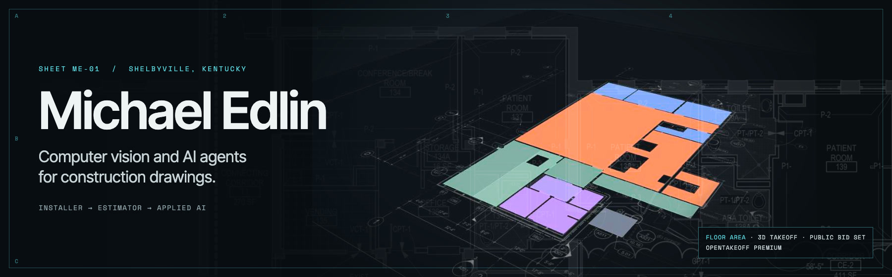
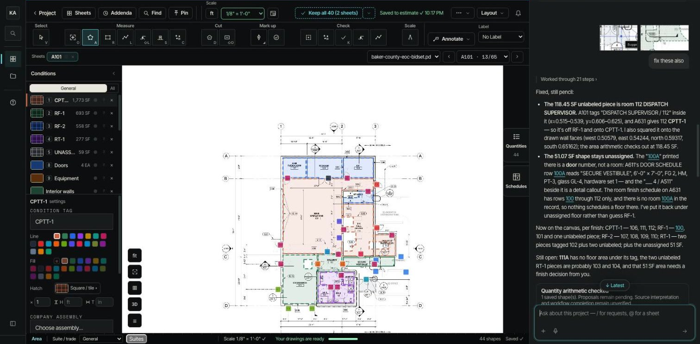
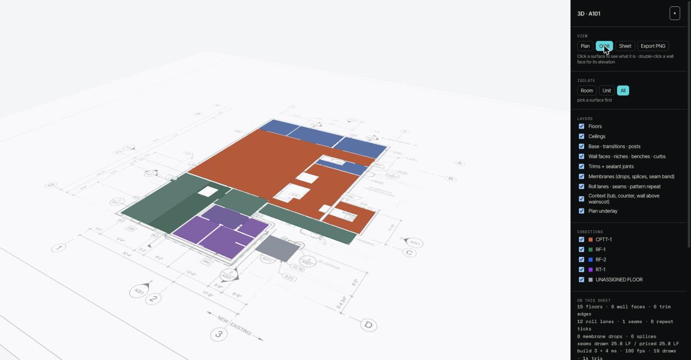
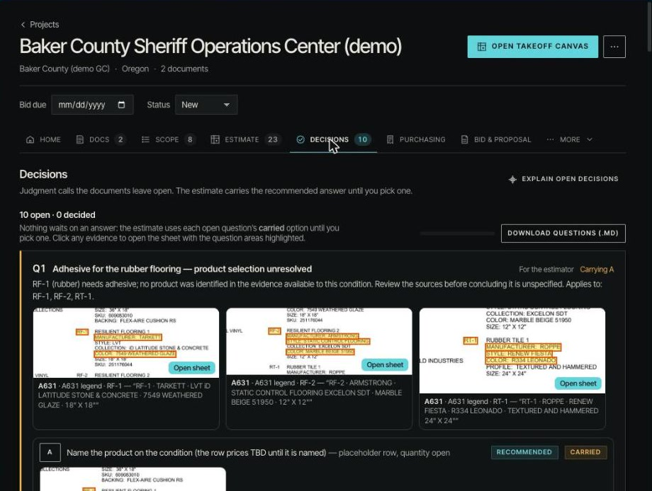
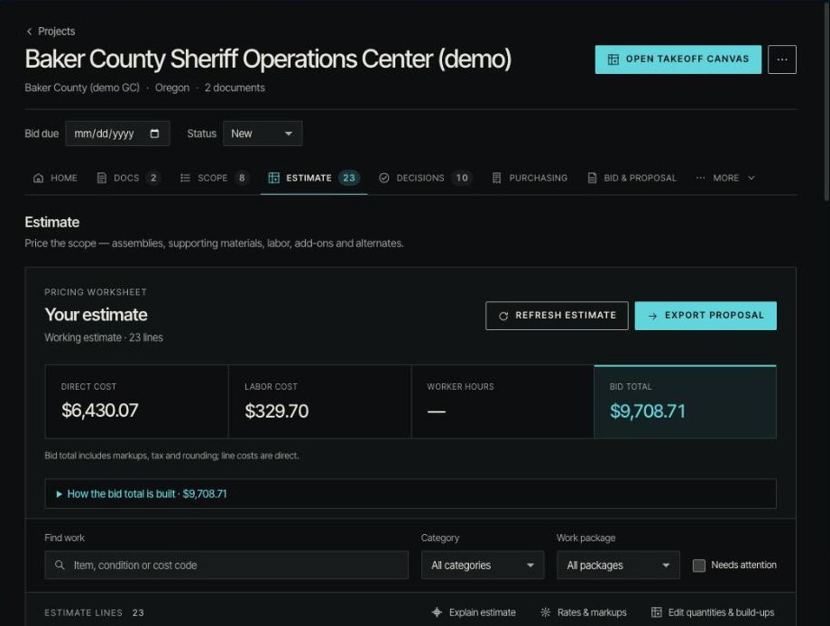
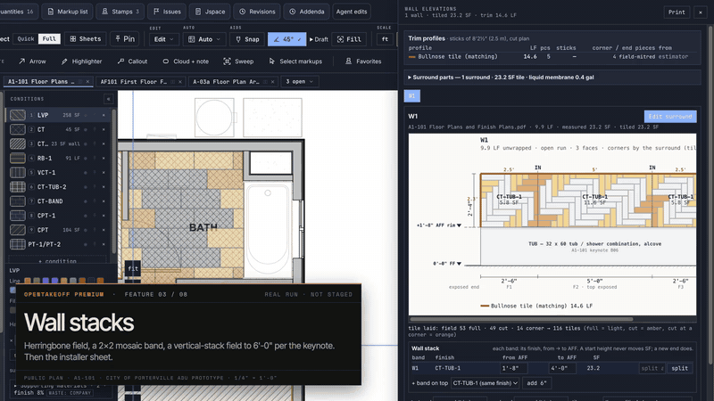
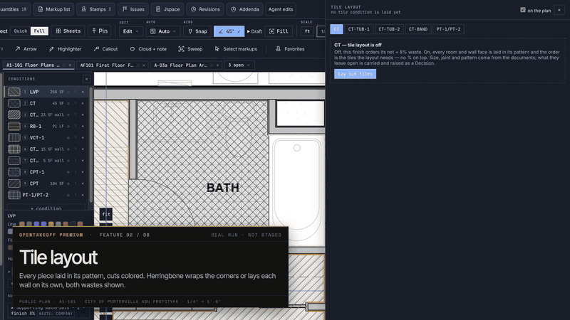

**Head of Estimating & Preconstruction · Founder, [Kentucky AI](https://kentucky-ai.com) · Creator of [OpenTakeoff](https://github.com/Kentucky-ai/opentakeoff)**

[Résumé + work](https://michael.kentucky-ai.com) &nbsp;·&nbsp; [LinkedIn](https://www.linkedin.com/in/michael-edlin-695127412/) &nbsp;·&nbsp; [Hugging Face](https://huggingface.co/Kentucky-ai) &nbsp;·&nbsp; [Try Premium, no sign-up](https://sandbox.kentucky-ai.com) &nbsp;·&nbsp; michael@kentucky-ai.com

I've spent 13+ years in construction: installing floors, running my own flooring company, then leading a commercial estimating department that bids into 13 states. Now I also train the vision models, build the agent tools, and ship the software, then use it on live bids.

**Open to** applied AI, computer vision, solutions and forward-deployed engineering, and AI product roles. Relocation and travel are fine.

---

## Computer vision on construction drawings

Plans are hard for vision models: thin linework, hatches that look like walls, huge sheets, and text everywhere. A wrong edge also costs real money on a bid. So I build for measured geometry instead of a nice-looking mask.

| Model | What it does | How it's built | Where it stands |
|---|---|---|---|
| **[Floor area, seg6](https://huggingface.co/Kentucky-ai/floor-model-seg6)** | Sheet in, closed room polygons out | DeepLabV3 / ResNet-50 for floor, wall and closure classes, then vector assembly from the PDF linework: wall-line fitting, a doorway model, a jamb-to-jamb door-seal model | **96.3% of floor area found**, 5.4% false, 2.9% outside the building on 127 dev sheets. Sealed test still pending |
| **Floor area, live** | The model running in OpenTakeoff today | Same pipeline, earlier weights, plus an AI pass that checks and corrects rooms | **Median 95.9%** of estimators' hand takeoffs on 27 floor plans from 21 real bids, no human edits. 17 of 27 at 95%+, 3 failures |
| **[Walls](https://huggingface.co/Kentucky-ai/september-floor-model)** | Wall faces and runs for framing and drywall takeoff | SegFormer B2 context model plus scored vector segments | In progress, not at its bar yet |
| **Doors** | Find and type every door on a sheet | RF-DETR trained on CAD door layers and my own graded sheets, fused with vector swing-arc logic | In progress. Swing doors are strong; sliding, coiling and other rare types are the open problem |

**How I run the work**

- **Labels from real drawings:** human-traced rooms, plus truth mined from CAD layers (875 layered pages for floor area).
- **Honest scoring:** whole jobs held out, a sealed test set read only for go/no-go calls, and rulers set before the run. Failed experiments get written down too.
- **Infrastructure:** PyTorch, multi-GPU training on Lambda, MLflow, DVC, Label Studio, Hugging Face.
- **Language models:** [LoRA fine-tune of Gemma 4](https://huggingface.co/Kentucky-ai/div9-flooring-estimator-gemma4-31b) for Division 9 estimating on Apple Silicon. Compared DeepSeek, Qwen, Kimi and GLM against Claude across 112 logged takeoff runs, and published an [eight-model takeoff comparison](https://github.com/orgs/Kentucky-ai/discussions/507).

---

## OpenTakeoff Premium

The hosted workspace: takeoff, estimate and bid for any trade, with an assistant that works on the same sheet as the estimator. Everything below is the current build on a public 65-sheet bid set, and [you can open it yourself](https://sandbox.kentucky-ai.com) with no sign-up.

The assistant measures, cites the schedule row behind each call, and leaves its work in pencil until a person accepts it.

Every measured surface in 3D, sitting on the sheet it came from.

<table>
<tr>
<td width="50%"></td>
<td width="50%"></td>
</tr>
<tr>
<td><b>Decisions.</b> Where the documents leave a call open, you get options with the evidence zoomed in. The estimate carries the recommended answer until a person picks.</td>
<td><b>Estimate.</b> Quantities flow into priced lines, the proposal and the buy list. Demo prices, not a real bid.</td>
</tr>
<tr>
<td></td>
<td></td>
</tr>
<tr>
<td><b>Wall stacks.</b> Walls unwrap into faces, openings and finish bands.</td>
<td><b>Tile layout.</b> Each tile laid from the scheduled size, joint and pattern, so the order comes from the layout.</td>
</tr>
</table>

---

## Also building

- **[OpenTakeoff](https://github.com/Kentucky-ai/opentakeoff):** the open-source core (AGPL-3.0). PDF takeoff in the browser, plus a takeoff engine agents drive natively over MCP: [`opentakeoff-mcp`](https://www.npmjs.com/package/opentakeoff-mcp). People and agents share the same geometry and math, and every number traces back to the sheet.
- **[OpenTakeoff Academy](https://github.com/Kentucky-ai/opentakeoff-academy):** open benchmark and certification arena for construction-takeoff agents.
- **Spline:** the closed-source estimating platform OpenTakeoff grew out of, in daily use on live bids.

## The operator side

- Tripled annual awarded work from $2.5M to $7.5M with no added headcount, before any AI.
- Then took weekly bid output per person from about $0.55–1M to $2.5–3.5M with software I built and deployed. That's bid value produced, not awarded revenue.
- Trained the users, wrote the procedures, and governed adoption and model spend. Self-reported, and happy to walk through it.

## Stack

**ML:** PyTorch · DeepLabV3 · SegFormer · SAM 2 · RF-DETR · LoRA / QLoRA · MLX · MLflow · DVC · Label Studio 
**Software:** Python · FastAPI · TypeScript / React · PostgreSQL · Docker · MCP · architectural PDF parsing 
**Construction:** Division 9 estimating · Autodesk Takeoff · BuildingConnected · Procore · STACK · Bluebeam · NWFA certified installer

## Off the clock

Finished a research paper on AI takeoff with Alejandro Amador. Reading *Blood Meridian* and westerns. Playing futsal, riding motorcycles.

 
<a href="https://michael.kentucky-ai.com"><b>Résumé and work →</b></a> &nbsp;·&nbsp; <a href="mailto:michael@kentucky-ai.com"><b>michael@kentucky-ai.com</b></a>

